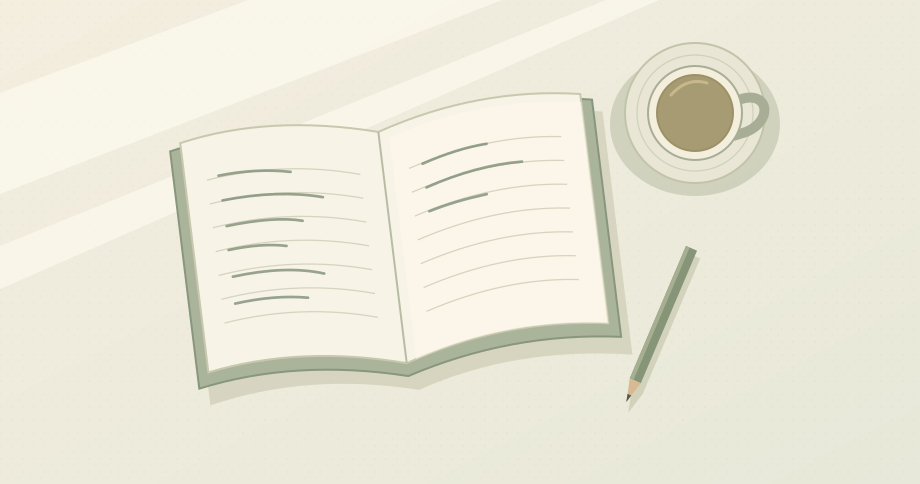

读完一章，桌上只剩一页草稿。最上面抄着一个定义，下面留了一道空白。我在空白里写：如果把这个条件去掉，会发生什么？

*窗边的桌面，随笔插图。*

过去总想把笔记写得完整一点，章节读完就补上小结。后来回看时，最能把思路接起来的，常常是当时没回答完的那个问题。它提醒我曾在哪一步停下来，也给下一次阅读留了个起点。

> 合上书以后，试着只凭记忆把那个问题再写一遍。

如果明天还有空，就从这道空白开始。
